# ECE241 Project - Milestone 2: Tick-to-Trade Latency

## Summary

We are building a small high-frequency trading system on the DE1-SoC, inspired by quantitative trading firms. Recorded market data streams out of on-chip ROM into a live order book. A market-making strategy quotes around the mid price, a risk gate checks every order, and a simulated exchange fills us when the market trades at or through our quotes.

In Milestone 2 the loop was closed:

- **Market side (Parth):**
  - The matching engine turns market trades into fills on our quotes.
  - A PS/2 keyboard lets you type your own orders into the market during the demo.
  - An order arbiter merges those typed orders with the ROM feed without losing or delaying either.
- **Trading side (Pierce):**
  - A P&L tracker turns fills into a position and a profit or loss.
  - The position feeds back into the strategy (inventory skew) and the risk gate (position limits).
  - The VGA monitor now shows the book, our quotes, position, P&L, fills, typed orders and risk status at once, with an arrow-key cursor for reading any price level.

Every block has its own Python reference model. The models are chained into one system model, and the complete hardware matches it on every one of 1010 messages (1000 from the ROM, 10 typed on the keyboard). Tick-to-trade, from a market message arriving to our order going out, is still 7–8 clock cycles (140–160 ns at 50 MHz), because the new blocks add no cycles to that path.

## Work completed in Milestone 2

| Parth (market side) | Pierce (trading side) |
|---|---|
| Matching engine ([matching_engine.v](https://github.com/ParthB21/tick-to-trade-latency/blob/main/rtl/matching_engine.v)): simulated exchange. Fills our quote at our price when a market trade happens at or through it, never more than the quote's size | P&L tracker ([pnl_tracker.v](https://github.com/ParthB21/tick-to-trade-latency/blob/main/rtl/pnl_tracker.v)): position and cash from every fill, P&L marked at the mid price |
| Order arbiter ([order_arbiter.v](https://github.com/ParthB21/tick-to-trade-latency/blob/main/rtl/order_arbiter.v)): 3-state FSM that merges the ROM feed and keyboard orders into the order book. Keyboard wins ties, nothing is lost, 0 added cycles | Strategy v2 ([strategy.v](https://github.com/ParthB21/tick-to-trade-latency/blob/main/rtl/strategy.v)): inventory skew (quotes shift against our position, SW[2]), plus a clamp so skew can never push a quote across the book |
| PS/2 keyboard order entry: our own receiver ([ps2_rx.v](https://github.com/ParthB21/tick-to-trade-latency/blob/main/rtl/ps2_rx.v)), scan-code decoder ([kb_decoder.v](https://github.com/ParthB21/tick-to-trade-latency/blob/main/rtl/kb_decoder.v)) and a 4-state entry FSM ([order_entry.v](https://github.com/ParthB21/tick-to-trade-latency/blob/main/rtl/order_entry.v)) that builds messages in the ROM format and rejects bad or crossing orders | Risk gate ([risk_gate.v](https://github.com/ParthB21/tick-to-trade-latency/blob/main/rtl/risk_gate.v)): long/short limits now use the live position. The one-sided-book flag now shows the latest quote instead of latching, so RISK OK can show |
| Order book: order IDs widened to `{source, id}` so typed and ROM orders never collide (2048-entry order table) | VGA dashboard ([dashboard.v](https://github.com/ParthB21/tick-to-trade-latency/blob/main/rtl/dashboard.v)): POS/PNL text, then the 4-line status panel redrawn for a 16:9 monitor (built on Parth's first 6-line panel) |
| HEX displays: entry view and fills view, binary-to-decimal without `/` or `%` ([bin2bcd_comb.v](https://github.com/ParthB21/tick-to-trade-latency/blob/main/rtl/bin2bcd_comb.v)), letters on [seg7.v](https://github.com/ParthB21/tick-to-trade-latency/blob/main/rtl/seg7.v) | Arrow-key book cursor ([book_cursor.v](https://github.com/ParthB21/tick-to-trade-latency/blob/main/rtl/book_cursor.v)): up/down jump to the next non-empty level, its bar turns white and its side, price and shares show in the top-right corner |
| Integration into [hft_top.v](https://github.com/ParthB21/tick-to-trade-latency/blob/main/rtl/hft_top.v): PS/2 pins, arbiter in the feed path, fills into Pierce's P&L tracker. First version of the VGA status text panel | Integration: fill interface defined in [hft_top.v](https://github.com/ParthB21/tick-to-trade-latency/blob/main/rtl/hft_top.v), Quartus project updated with every M2 source |
| Python models per block ([matching.py](https://github.com/ParthB21/tick-to-trade-latency/blob/main/python/matching.py), [order_entry.py](https://github.com/ParthB21/tick-to-trade-latency/blob/main/python/order_entry.py)), chained with Pierce's into [system_model.py](https://github.com/ParthB21/tick-to-trade-latency/blob/main/python/system_model.py). System testbench that types real PS/2 frames into `hft_top` | Python models: [pnl.py](https://github.com/ParthB21/tick-to-trade-latency/blob/main/python/pnl.py), skew in [strategy.py](https://github.com/ParthB21/tick-to-trade-latency/blob/main/python/strategy.py), [risk.py](https://github.com/ParthB21/tick-to-trade-latency/blob/main/python/risk.py), screen model [dashboard.py](https://github.com/ParthB21/tick-to-trade-latency/blob/main/python/dashboard.py) |
| Verification: order book 27/27, matching engine 13/13 + 500/500 vectors, arbiter 6/6 (371 sent = 371 received), keyboard 10/10, system 1010/1010 messages with skew off and on | Verification: P&L 521 cycles, strategy 225 vectors, risk gate 244 cycles, dashboard 3 frames × 76,800 pixels, cursor 24/24, end-to-end 1000/1000 orders + every pixel of the frame |

### Response to the Milestone 1 feedback

| Feedback | What we did | Where |
|---|---|---|
| A Python model for each block, chained into a model of the whole system, with a system-level testbench | One model per block, chained in `system_model.py`. `hft_system_tb.v` runs the real `hft_top`, steps the ROM and types on the PS/2 pins; `sys_compare.py` checks every message | Section 5 |
| Explain how the order book finds the best bid/ask (datapath diagram) | Masks + priority encoders; no search over the 64 levels | Section 1, Figure 2 |
| Define and test what happens when the feed and the keyboard send at the same time | Written collision policy, 4 test cases with zoomed waveforms | Section 3 |
| Bring up the strategy's skew in steps | Skew is off by default (SW[2] = 0) and the system test runs with it off and on | Sections 5 and 7 |

## Section 0: System overview

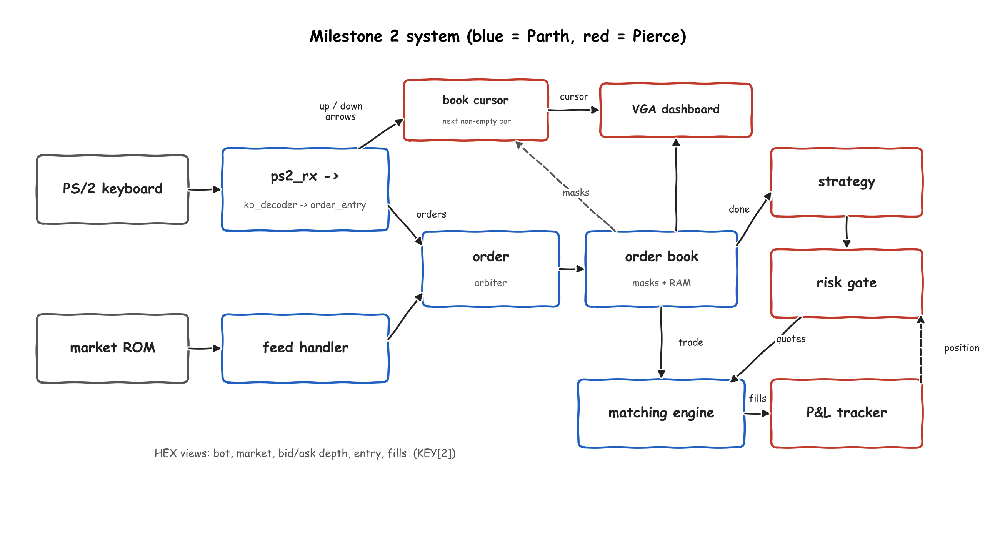

*Figure 1: Milestone 2 system. The ROM feed and the keyboard both enter through the order arbiter. The order book triggers the strategy, whose quote goes through the risk gate to the matching engine. Fills go to the P&L tracker, whose position goes back to the strategy and the risk gate. Blue = Parth, red = Pierce, grey = inputs.*

What happens on each clock cycle after the order book finishes a message (cycle d):

| Cycle | What happens |
|---|---|
| d | The book pulses `done`; best bid/ask are already updated. If the message was a trade, `trade_valid` = 1. The strategy snapshots the book and our position |
| d + 1 | The matching engine outputs a fill if the trade hit one of our quotes |
| d + 2 | The P&L tracker updates position and cash. The strategy's new quote is ready (`quote_valid`) |
| d + 3 | The risk gate sends the checked quote (`order_valid`); the matching engine reloads the quote's size |

Tick-to-trade (from `msg_start`, when a message is read, to `order_valid`):

| Stage | Cycles |
|---|---|
| Feed handler + order book | 4 (ADD) or 5 (CANCEL/TRADE) |
| Strategy | 2 |
| Risk gate | 1 |
| **Total** | **7–8 cycles = 140–160 ns at 50 MHz** |

The arbiter and the matching engine are not on this path. The arbiter's handshake is combinational in its IDLE state, and the matching engine works alongside the strategy.

## Section 1: Order book: how best bid and best ask are found (Parth)

### 1.1 Summary

The order book never searches its 64 price levels. Best bid and best ask come out in the same clock cycle that a level changes, from two 64-bit registers and two priority encoders. The only change for M2 is that order IDs now carry a source bit, so an order typed on the keyboard and an order from the ROM can have the same number without colliding.

### 1.2 How it works

- **Level memory** (128 × 13 bits, address `{side, price}`) stores only the total quantity waiting at each price. It is never searched.
- **Two 64-bit mask registers**, `bid_mask` and `ask_mask`, have bit *p* = 1 when price level *p* has any quantity. In the `LVL_UPD` state, the level's new quantity is compared with 0 and the result is written into that one bit. That costs one comparator and one flip-flop write per message.
- **Two priority encoders** ([prio_enc64.v](https://github.com/ParthB21/tick-to-trade-latency/blob/main/rtl/prio_enc64.v)) read the masks: the highest set bit of `bid_mask` is the best bid, and the lowest set bit of `ask_mask` is the best ask. They are purely combinational, so the new best prices appear on the same clock edge as the new mask.
- **Order table** (now 2048 × 21 bits, address `{source, id}`) is used only by CANCEL and TRADE to look up an order's side, price and remaining quantity.
- **Two copies of the level memory** (`lvl_view`, `lvl_view2`) give the VGA dashboard and the HEX depth views their own read ports, so displaying never stalls the book.

**M2 change.** The arbiter adds a source bit as order ID bit 10 (0 = ROM, 1 = keyboard). The order table doubled to 2048 entries, so the memory clear after reset now takes 2048 cycles (41 µs). Everything else, including the 8-state FSM from Milestone 1, is unchanged.

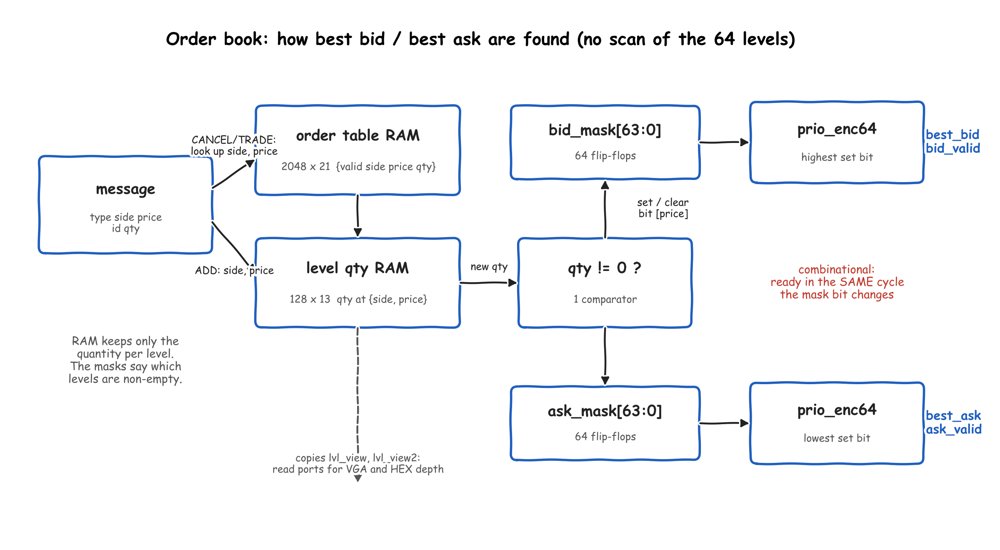

*Figure 2: Order book datapath. The masks and priority encoders give the best bid and ask without a search; the level memory holds quantities only.*

### 1.3 Simulation results

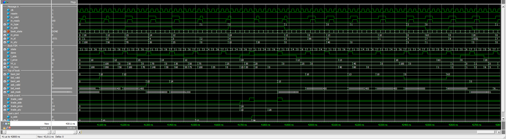

*Figure 3: The order book test after the 41 µs memory clear (41,000–42,800 ns). Each time the FSM passes state 6 (LVL_UPD), `bid_mask`/`ask_mask` change, and `best_bid`/`best_ask` change on the same clock edge. Example: bid_mask 0x400 → 0x1400 and best_bid 10 → 12. The two trades (around 41.7 µs and 41.9 µs) pulse `trade_valid`.*

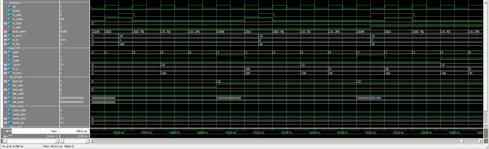

*Figure 4: Close-up of the first two ADD messages, with state names. The FSM goes IDLE → ADD_TBL → LVL_RD → LVL_UPD → DONE (4 cycles per ADD). On the edge that leaves LVL_UPD, bit 10 of `bid_mask` sets and `best_bid` becomes 10; on the next ADD, bit 12 sets and `best_bid` becomes 12.*

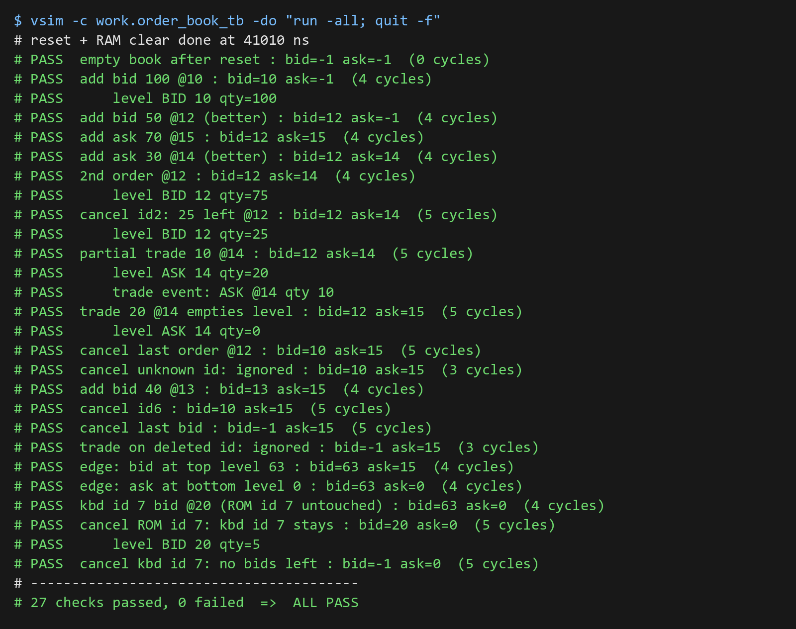

*Figure 5: Order book testbench: all 27 checks pass. These are the 23 Milestone 1 checks plus 4 for the source bit; for example, cancelling ROM order 7 does not touch keyboard order 7.*

## Section 2: Matching engine (Parth)

### 2.1 Summary

The matching engine is our simulated exchange. It decides when the replayed market would have traded with our own resting quotes, and sends those fills to Pierce's P&L tracker. Without it, the bot quotes but never trades.

### 2.2 How it works

The order book's trade event means "the resting order on side S at price p just traded Q shares".

- **Bid-side trade at p**: someone sold down to p. Our bid fills if it is live and `our_bid_px ≥ p`.
- **Ask-side trade at p**: someone bought up to p. Our ask fills if it is live and `our_ask_px ≤ p`.

This is the "at or through" rule: if the market trades at our price or past it, we would have been filled first.

- The fill price is **our** price, and the fill quantity is `min(trade quantity, shares left on our quote)`.
- `bid_rem`/`ask_rem` count the shares left on each quote. They reload to the quote size every time the risk gate sends a new quote (`order_valid`), so one quote can never fill more than its size.
- The fill comes one cycle after the trade (d + 1). The next quote arrives at d + 3, so a fill is always checked against the quote that was resting *before* the message, as on a real exchange.
- Our fills do not change the replayed book. This is the usual assumption when replaying recorded data ("no market impact").

It is a datapath with no FSM: 2 comparators, 2 minimum selectors, 2 subtractors and registers.

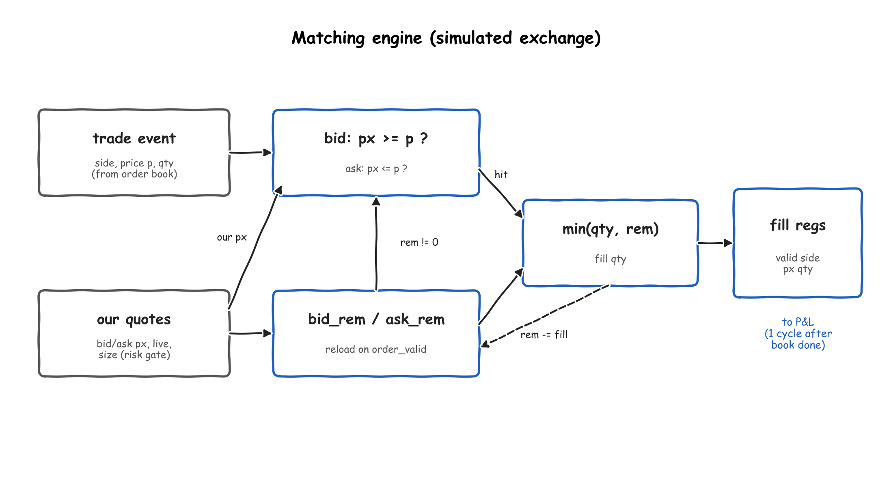

*Figure 6: Matching engine datapath.*

### 2.3 Simulation results

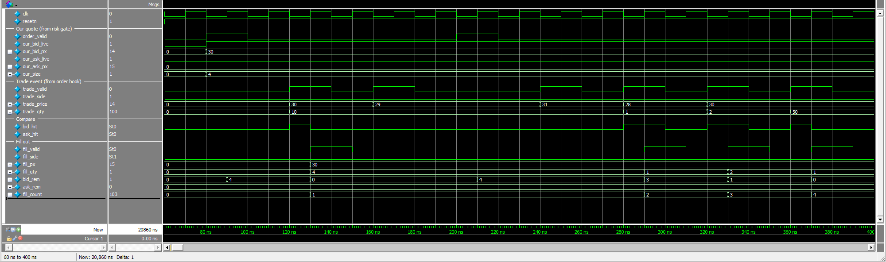

*Figure 7: Our bid at 30 for 4 shares (60–400 ns).*
- *A trade at 30 fills all 4 at 30, and `bid_rem` goes to 0.*
- *A second trade (at 29) does not fill, because the quote is used up.*
- *After a new quote (`order_valid` at 200 ns), a trade at 31 does not fill (it is above our bid), and a trade at 28 fills 1 share at our price 30.*

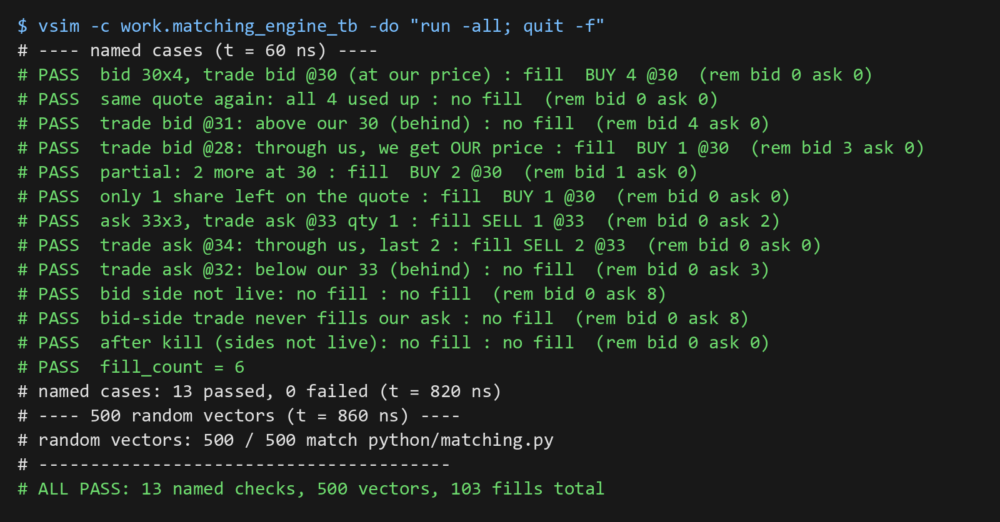

*Figure 8: Matching engine testbench: 13/13 hand-written cases (at, through and behind our price, partial fills, a side not live, the kill switch) and 500/500 random vectors match the Python model `matching.py`.*

## Section 3: Order arbiter (Parth)

### 3.1 Summary

The order book has one input but now two sources: the ROM feed and the keyboard. The arbiter passes them through one message at a time. Nothing is lost, nothing is sent twice, and the book's `done` goes back only to the source whose message it was.

### 3.2 How it works

Collision policy:

1. A source is granted only when the arbiter is IDLE and the book is ready.
2. If both ask in the same cycle, **the keyboard wins**. Typed orders are rare (a person typing), so the feed is never starved.
3. **The ROM message is not lost.** The feed handler stays in its SEND state with `msg_valid` high and its message unchanged until it is granted.
4. **The keyboard message is not lost.** Order entry holds `k_valid` and the message until it is granted, and ignores keys until then.
5. The book's `done` goes back only to the owner (`f_done` or `k_done`), so the feed handler never mistakes a keyboard message finishing for its own.
6. The source becomes order ID bit 10: `b_id = {source, id}`.

The handshake in IDLE is combinational, so the arbiter adds **0 cycles** to tick-to-trade.

| # | State | What happens in this state | Next state |
|---|---|---|---|
| 0 | IDLE | `b_valid = k_valid OR f_valid`. Passes on the keyboard message if `k_valid`, otherwise the feed's. `k_ready = book ready AND k_valid`; `f_ready = book ready AND f_valid AND NOT k_valid` | KBD if the keyboard is granted, FEED if the feed is granted, otherwise stay |
| 1 | FEED | `owner = 0`; the book's `done` goes to the feed handler (`f_done`) | IDLE on `done` |
| 2 | KBD | `owner = 1`; the book's `done` goes to order entry (`k_done`) | IDLE on `done` |

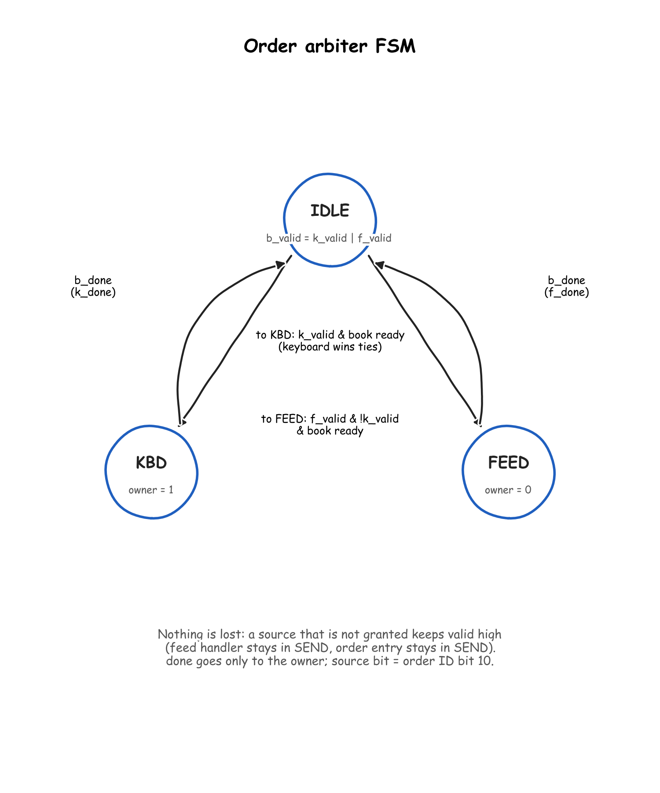

*Figure 9: Order arbiter FSM.*

### 3.3 Simulation results

The testbench uses stand-ins for the feed, keyboard and book, with the real handshakes and timing. Each message carries a unique tag in its ID field, and the book stand-in logs every message it accepts.

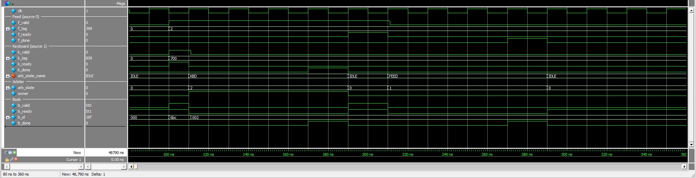

*Figure 10: Case 1, both sources at once (80–360 ns). `f_valid` and `k_valid` rise together at 100 ns. The keyboard is granted first (`b_id` = 0x6BC = keyboard, order 700), while `f_valid` stays high. The feed message is accepted at 210 ns (`b_id` = 0x002), and `k_done`/`f_done` each go only to their own source.*

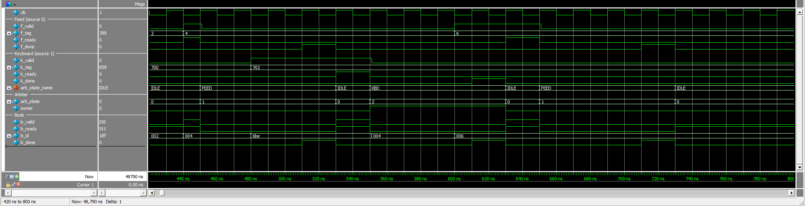

*Figure 11: Case 2, keyboard while the book is busy (420–800 ns). The book accepts feed message 4 at 450 ns. The keyboard message arrives at 480 ns, waits with `k_ready` low, and goes next at 550 ns. Feed message 6 follows at 650 ns.*

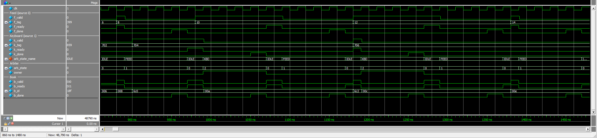

*Figure 12: Case 3, feed messages back to back with keyboard messages inserted (860–1,480 ns). Order: F8, K704, F10, then K706 and F12 in the same cycle (keyboard first), then F12, F14. `f_done` pulses only for feed messages and `k_done` only for keyboard messages.*

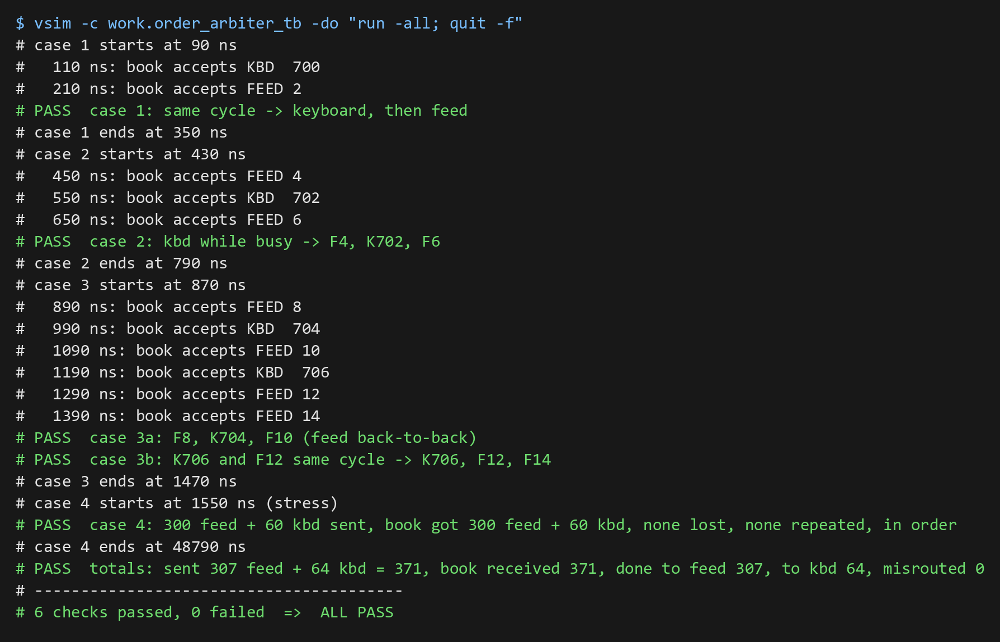

*Figure 13: Arbiter testbench: 6/6 checks. They include a stress test of 300 feed messages with random gaps and 60 keyboard messages at random times. 371 messages were sent and 371 received, none repeated, in order for each source, and no `done` went to the wrong source.*

## Section 4: Keyboard order entry (Parth)

### 4.1 Summary

During the demo, orders can be typed on a PS/2 keyboard. Each typed order becomes a 32-bit message in exactly the ROM format and goes through the arbiter into the order book, so the bot reacts to it like any other market order. Orders that are invalid or would cross the book are rejected with `Err` and never sent.

| Typed | Message |
|---|---|
| `B <price> Space <qty> Enter` | ADD a bid; gets the next keyboard order ID (1, 2, …) |
| `S <price> Space <qty> Enter` | ADD an ask |
| `X <id> Enter` | CANCEL that keyboard order |
| `T <id> Space <qty> Enter` | TRADE against that keyboard order (makes the market trade on demand) |
| `Esc` / `Backspace` | Clear the line / delete the last digit |

Rejected (shows `Err`, sends nothing):
- price > 63
- quantity 0 or > 8191
- ID 0 or > 1023
- an ADD that would cross the book (a bid at or above the best ask, or an ask at or below the best bid)

### 4.2 How it works

The keyboard path has three blocks in a row:

- **[ps2_rx.v](https://github.com/ParthB21/tick-to-trade-latency/blob/main/rtl/ps2_rx.v)**: our own receive-only PS/2 receiver.
  - The keyboard's clock and data pins pass through 2-flip-flop synchronisers, and a third flip-flop finds the falling edges of the PS/2 clock.
  - On each falling edge one bit is shifted in: 11 bits per frame (start, 8 data bits LSB first, odd parity, stop).
  - A frame with a bad start, stop or parity bit is dropped (`frame_err`).
  - If the clock stops for 1 ms, the bit counter resets, so a half-received frame cannot shift every later byte.
- **[kb_decoder.v](https://github.com/ParthB21/tick-to-trade-latency/blob/main/rtl/kb_decoder.v)** turns scan codes into key codes.
  - `F0` means the next byte is a key release, so that key is ignored.
  - `E0` marks an extended key (keypad Enter and the arrow keys).
  - Any other byte is a key press, looked up in a table: digits, B S X T, Space, Enter, Esc, Backspace, and the up/down arrows for Pierce's cursor.
- **[order_entry.v](https://github.com/ParthB21/tick-to-trade-latency/blob/main/rtl/order_entry.v)** builds the message.
  - Digits are stored as typed, as 4 decimal (BCD) digits, which makes the HEX display simple.
  - On Space or Enter they are converted to binary with shifts and adds instead of a multiplier: ×10 = (x << 3) + (x << 1).
  - The value is checked against the limits and the current best bid/ask before anything is sent.

| # | State | What happens in this state | Next state |
|---|---|---|---|
| 0 | CMD | Waits for a command letter (B, S, X or T); remembers which | NUM1 on a letter |
| 1 | NUM1 | Digits build the price (B/S) or the order ID (X/T) | Space (B/S/T) → NUM2. Enter on X with a valid ID → SEND. Invalid → CMD with `Err` |
| 2 | NUM2 | Digits build the quantity | Enter, all checks pass → SEND. A check fails → CMD with `Err` |
| 3 | SEND | `k_valid = 1` with the finished message; keys are ignored | CMD when the arbiter accepts it (`k_ready`). The display shows the order ID, e.g. `b d 0001` |

Esc always returns to CMD, and a new letter starts a new command.

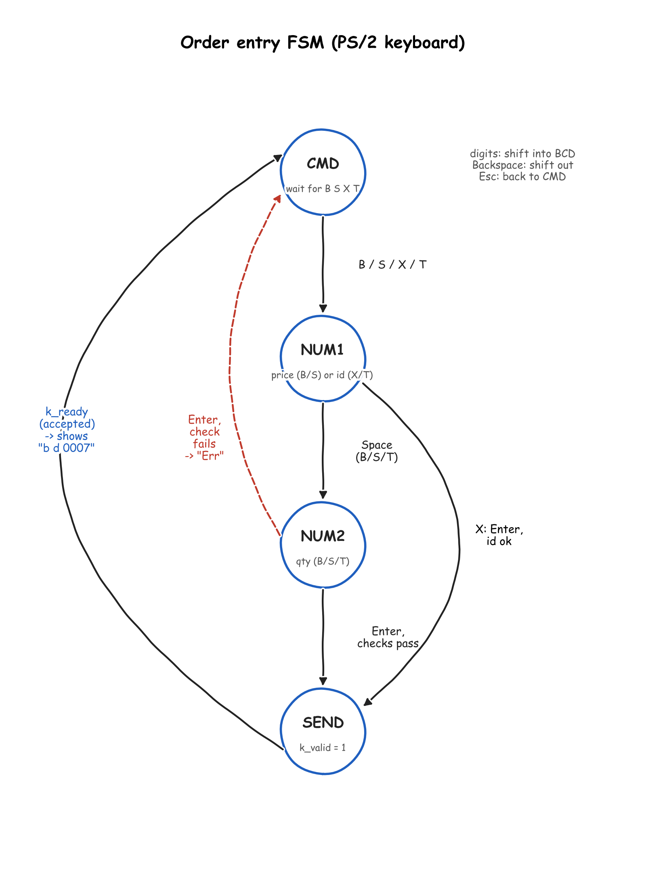

*Figure 14: Order entry FSM.*

### 4.3 Simulation results

The testbench sends real PS/2 frames. It uses a 2 µs PS/2 clock half-period instead of a real keyboard's 30–50 µs, to keep the simulation short; the receiver only looks for clock edges, so this does not change its behaviour.

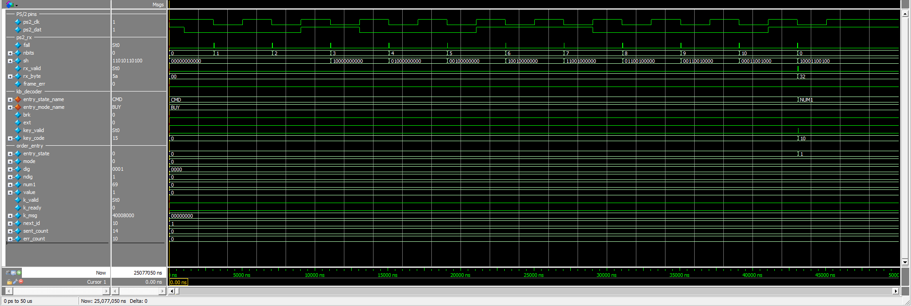

*Figure 15: One PS/2 frame (0–50 µs). The data line carries start, the 8 bits of 0x32 (the B key), parity and stop, read on each falling edge of `ps2_clk` (`fall`, `nbits` 1–10). After the 11th bit, `rx_valid` pulses with `rx_byte` = 0x32, the decoder outputs key code 10 (B), and the entry FSM moves to NUM1.*

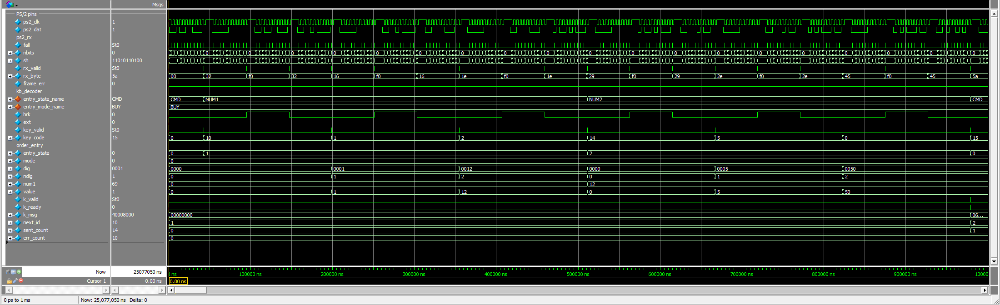

*Figure 16: Typing "B12 50 Enter" (0–1 ms, 18 PS/2 bytes). Each key arrives as its make code, then F0 and the code again on release (32 F0 32, 16 F0 16, …). Only presses produce `key_valid`. The FSM goes CMD → NUM1 (digits 1, 2 build 12) → NUM2 (5, 0 build 50) → SEND when Enter arrives at 979 µs.*

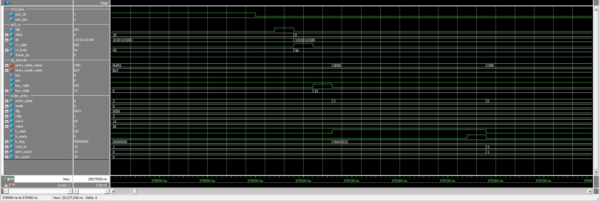

*Figure 17: Close-up of the Enter key (978.9–979.4 µs). Enter (key code 15) moves the FSM to SEND with `k_valid` = 1 and `k_msg` = 0x06002032 = ADD, bid, price 12, ID 1, quantity 50. The arbiter stand-in accepts it 7 cycles later (`k_ready`), the FSM returns to CMD, and the next keyboard ID becomes 2.*

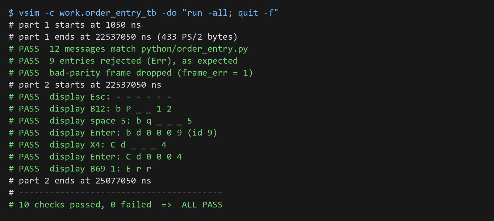

*Figure 18: Keyboard testbench: 10/10 checks. 24 typed lines (433 PS/2 bytes) produce 12 messages identical to the Python model `order_entry.py`. 9 entries are rejected as expected, a frame with bad parity is dropped, and 7 checks confirm what the HEX displays show.*

## Section 5: Reference models and full-system test (Parth)

### 5.1 Summary

Each block has a Python model with the same inputs and outputs as its Verilog, checked by that block's testbench. The models are chained into one model of the whole system, and the complete hardware (`hft_top`, the design that goes on the board) is checked against it on every message.

### 5.2 How it works

| Block | Python model | Checked by |
|---|---|---|
| Order book | `ref_model.py` (source bit added) | `order_book_tb`, `feed_book_tb` + `compare.py` (1000/1000) |
| Matching engine | `matching.py` | `matching_engine_tb` |
| Keyboard path | `order_entry.py` | `order_entry_tb` |
| Strategy (Pierce) | `strategy.py` | `strategy_tb` |
| Risk gate (Pierce) | `risk.py` | `risk_gate_tb` |
| P&L tracker (Pierce) | `pnl.py` | `pnl_tracker_tb` |
| **Whole system** | `system_model.py` chains all of the above | `hft_system_tb` + `sys_compare.py` |

- `system_model.py` replays the ROM plus a keyboard script (`sim/kb_script.txt`). After every message it writes:
  - the best bid and ask
  - our quotes after the risk gate
  - any fill
  - position, cash and P&L
- `hft_system_tb.v` runs the real `hft_top`. It steps the ROM with KEY[1] and types the same script as real PS/2 frames on the keyboard pins. It logs the same values from inside the design, and `sys_compare.py` compares the two files column by column.
- The keyboard script covers:
  - adds, cancels, and a typed trade that fills our ask
  - a crossing add, a bad price and a quantity of 0
  - Backspace and Esc
  - a cancel of an unknown ID and a trade on a deleted order
  - an order typed after the ROM has ended

### 5.3 Results

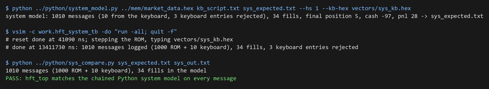

*Figure 19: Full-system test, half-spread 1, skew off. The hardware matches the chained model on all 1010 messages (1000 ROM + 10 keyboard, 3 typed entries rejected), including 34 fills and the position, cash and P&L after each one.*

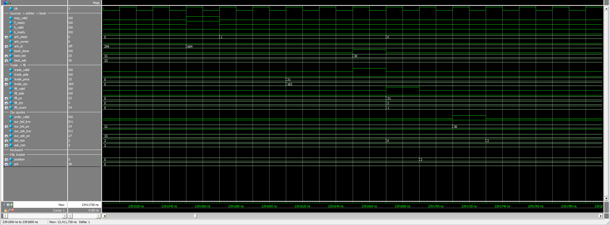

*Figure 20: The first fill of the system run, cycle by cycle.*
- *d (2,391,660 ns): the book finishes a trade message (`book_done`, `trade_valid`; a bid-side trade at 31 for 162 shares). Our bid is at 31 for 2.*
- *d + 1: `fill_valid`, we buy 2 at 31.*
- *d + 2: the P&L tracker's position goes 0 → 2.*
- *d + 3: `order_valid`, the new quote (bid 30) goes out and `bid_rem` reloads to 2.*

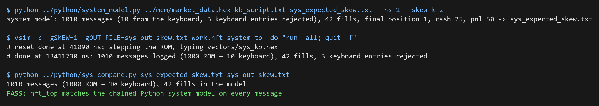

*Figure 21: The same system test with inventory skew on (SW[2], skew_k = 2). Skew changes the quotes and so the fills: 42 fills instead of 34. The hardware still matches the model on all 1010 messages.*

## Section 6: P&L tracker (Pierce)

### 6.1 Summary

The P&L tracker turns fills from the matching engine into our position (shares held, positive = long, negative = short) and our profit or loss. The position is sent back to the strategy for skew and to the risk gate for the position limits.

### 6.2 How it works

- **Buy fill**: position += quantity, cash −= price × quantity.
- **Sell fill**: position −= quantity, cash += price × quantity.
- **Mark**: the mid price (rounded down), updated whenever both sides of the book exist.
- **P&L** = cash + position × mark, registered, so it updates one cycle after position and cash.

It is a datapath with no FSM: a multiplier for price × quantity, adders, and a multiplier for position × mark. Position is 10-bit signed (the risk gate keeps it well inside that range), cash and P&L are 24-bit signed.

### 6.3 Simulation results

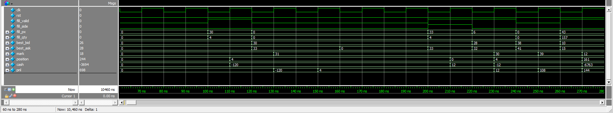

*Figure 22: A buy fill then a sell fill (60–280 ns).*
- *Buy 4 at 30: position 0 → 4 and cash 0 → −120 on the clock edge that samples `fill_valid`. P&L follows one cycle later: −120, then +4 once the mark of 31 applies.*
- *Sell 4 at 33: position returns to 0, cash becomes +12, and P&L is +12, the 3-tick profit on 4 shares.*

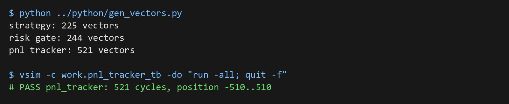

*Figure 23: P&L tracker testbench: 521 cycles match the Python model `pnl.py`, with the position reaching ±510 to test the extremes.*

## Section 7: Strategy v2, inventory skew (Pierce)

### 7.1 Summary

The strategy quotes a bid below and an ask above the mid price. In Milestone 2 both quotes also shift against our position: when we are long, both move down, so we sell more easily and buy less, and the reverse when short. This pulls the position back towards zero. Skew is off by default and turned on with SW[2].

### 7.2 How it works

- `mid2` = best bid + best ask (the mid in half-ticks, so there are no fractions).
- skew = position × skew_k / 8 ticks, rounded toward zero. On the board skew_k = 2, so 1 tick per 4 shares held.
- bid = floor(mid) − half-spread − skew, and ask = ceil(mid) + half-spread − skew.
- **No-cross clamp (new):** the bid is capped at best ask − 1 and the ask at best bid + 1. Without it, a large skew pushed the side that would reduce the position across the book; the risk gate rejected it, and the position could never unwind.

| # | State | What happens in this state | Next state |
|---|---|---|---|
| 0 | IDLE | Waits for the order book's `done` (trigger); on it, saves a snapshot of best bid/ask, half-spread, size, position and skew_k | CALC on trigger |
| 1 | CALC | Computes the quote from the snapshot and registers it | OUT |
| 2 | OUT | `quote_valid` = 1 for one cycle | IDLE |

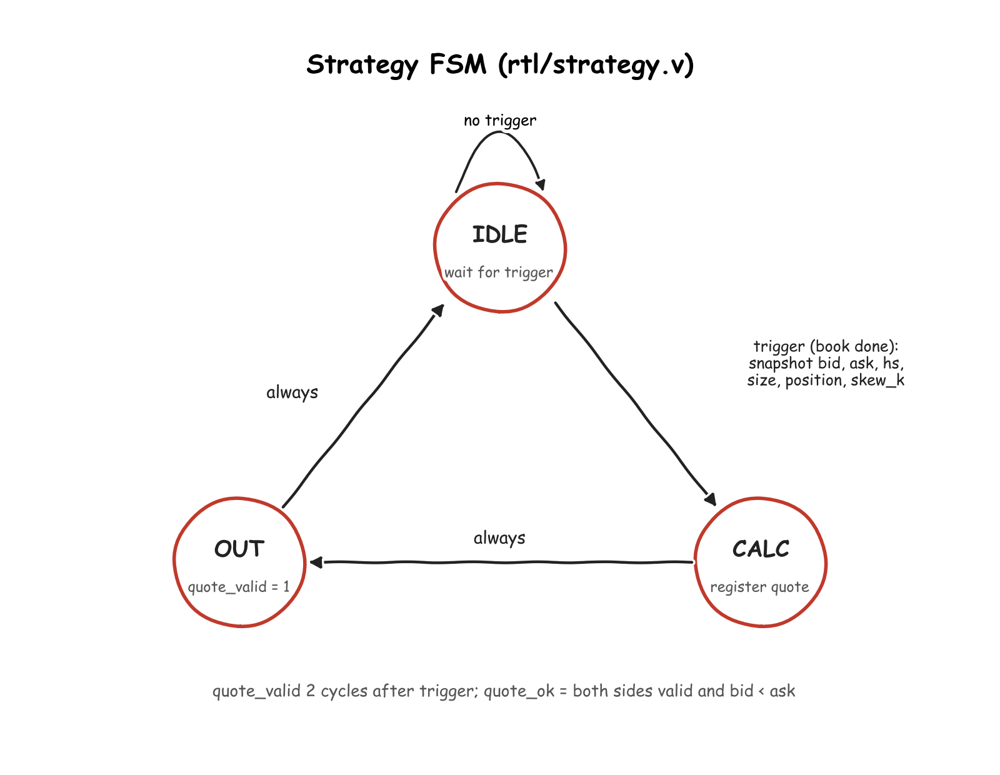

*Figure 24: Strategy FSM. A quote is ready 2 cycles after the trigger.*

### 7.3 Simulation results

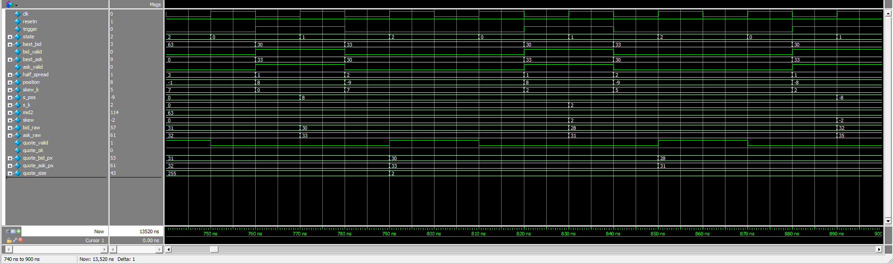

*Figure 25: The same book (30/33) and half-spread 1, with position +8 (740–900 ns).*
- *With skew_k = 0 the quote is 30/33.*
- *With skew_k = 2, skew = 8 × 2 / 8 = 2 ticks, so both sides move 2 ticks lower, to 28/31.*

*`quote_valid` comes 2 cycles after `trigger`. The testbench scrambles the live inputs right after each trigger to prove the strategy uses its snapshot (`s_pos` = 8, `s_k` = 2), not the live values.*

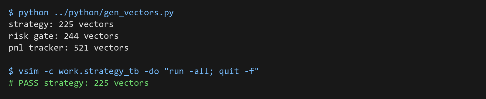

*Figure 26: Strategy testbench: 225 vectors match `strategy.py`, including skew in both directions, clamping at levels 0 and 63, and the no-cross clamp.*

## Section 8: Risk gate (Pierce)

### 8.1 Summary

Every quote passes through the risk gate before it reaches the exchange. All checks run in parallel in 1 cycle. A side that fails is pulled (made not live), so a stale quote is never left resting; the other side can still go out.

### 8.2 How it works

| Flag | Check | Blocks |
|---|---|---|
| 0 | Kill switch (SW[9]); latches until reset | Both sides; also pulls the resting quotes |
| 1 | Book one-sided (no mid price) | Both |
| 2 | Size above the limit | Both |
| 3 | Position + size > max position | Bid only (buying would break the long limit) |
| 4 | Position − size < −max position | Ask only (selling would break the short limit) |
| 5 | Quote crosses the market | The offending side |

**M2 changes:** checks 3 and 4 use the live position from the P&L tracker. Flag 1 now shows only the latest quote instead of latching: every replay starts with a one-sided book, so a sticky flag 1 meant "RISK OK" could never show. The other flags stay latched until reset and show on LEDR[5:0] and the VGA panel.

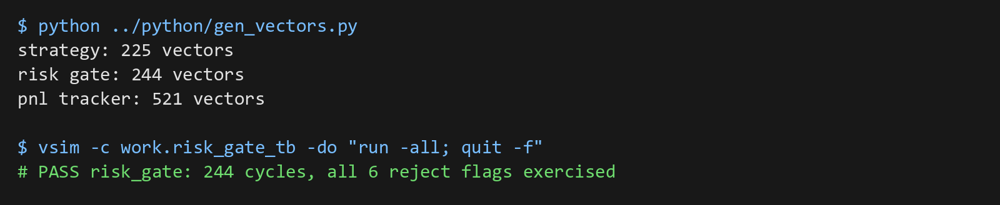

*Figure 27: Risk gate testbench: 244 cycles match `risk.py`, with all 6 reject flags exercised.*

## Section 9: VGA dashboard and book cursor (Pierce)

### 9.1 Summary

The VGA monitor shows everything at once, so the demo no longer needs the HEX views:
- **The ladder:** the live book (green bids growing left, red asks growing right, one bar per price level) with yellow markers on our two quotes.
- **The status panel:** four lines of text underneath.
- **The book cursor:** the arrow keys move it to any level and show that level's shares.

| Line | Colour | Example | Shows |
|---|---|---|---|
| 1 | White | `BOOK BID 30 ASK 34 SPREAD 04 MSGS 1234` | Market best bid/ask, market spread, ROM messages processed |
| 2 | Yellow | `BOT BID 30 ASK 34 SPREAD 04 SIZE 2 SKEW ON` | Our quotes (`--` = not live), our spread, quote size, SW[2] |
| 3 | White / green or red / cyan | `POS -037 PNL -99999 FILLS 0000` | Position, P&L (green ≥ 0, red < 0, capped at 5 digits), number of fills and the last fill |
| 4 | White (red on error) / green or red | `KEYS - - ----  RISK OK` | What is being typed on the keyboard, and the risk gate's flags |
| Top right | Green / red | `ASK 30 QTY 1144` | The cursor level's side, price and shares |

### 9.2 How it works

The dashboard FSM repaints every pixel continuously, in the bar colour, the text colour or black, instead of erasing. Old bars and digits are therefore overwritten automatically.

- **Per price level** (64 levels, top to bottom), it reads the bid and the ask quantity through the book's read port. It then draws 3 rows of 320 pixels: two rows of bar and one black gap.
- **After level 0**, it draws the 48 rows of text.
- **At the top of each frame**, it latches every number it will show and starts the binary-to-decimal converter, so a frame never mixes old and new values.

A frame takes 64 × (3 + 960) + 15,360 = 76,992 cycles = 1.54 ms.

Text is drawn 5 pixels wide and 9 rows tall so that it keeps its shape on our 16:9 monitor, which stretches the 4:3 picture sideways.

The book cursor ([book_cursor.v](https://github.com/ParthB21/tick-to-trade-latency/blob/main/rtl/book_cursor.v)) uses the same bid/ask masks as the order book. "Up" finds the nearest set bit above the cursor in `bid_mask OR ask_mask`, and "down" the nearest below, so it jumps from bar to bar in one cycle. It is off after reset until the first arrow key.

| # | State | What happens in this state | Next state |
|---|---|---|---|
| 0 | ADDR_BID | Sends the bid address of the current level to the book's read port. At level 63, latches all the values for the frame | ADDR_ASK |
| 1 | ADDR_ASK | Bid quantity arrives → bid bar length; sends the ask address | LATCH_ASK |
| 2 | LATCH_ASK | Ask quantity arrives → ask bar length | DRAW |
| 3 | DRAW | Plots one pixel per cycle: 3 rows × 320 pixels | Next level → ADDR_BID; after level 0 → TEXT |
| 4 | TEXT | Plots the 48 text rows, one pixel per cycle | ADDR_BID (next frame) after the last pixel |

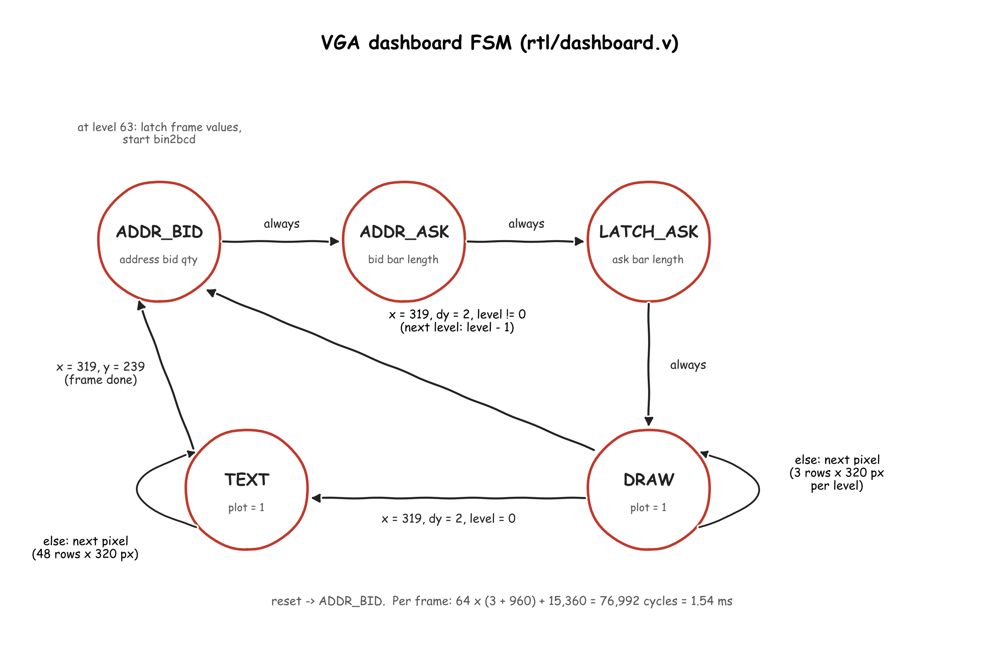

*Figure 28: Dashboard FSM.*

### 9.3 Simulation results

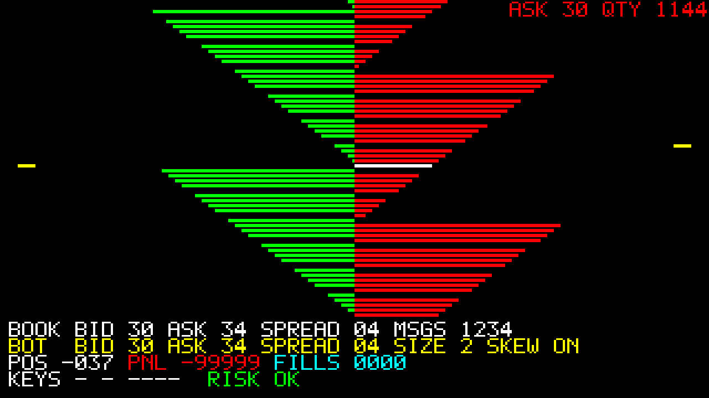

*Figure 29: A frame drawn by the dashboard in simulation (test case 0), scaled to 1280 × 720 as the 16:9 monitor shows it.*
- *The test book's bids and asks with our quote markers (yellow).*
- *The cursor on level 30 (white bar, readout at top right).*
- *The four panel lines with skew on, position −37, and a P&L of −123,456, shown as −99999 because the panel caps it at 5 digits.*

*The dashboard testbench checks 3 such frames against the Python screen model: 0 pixel mismatches.*

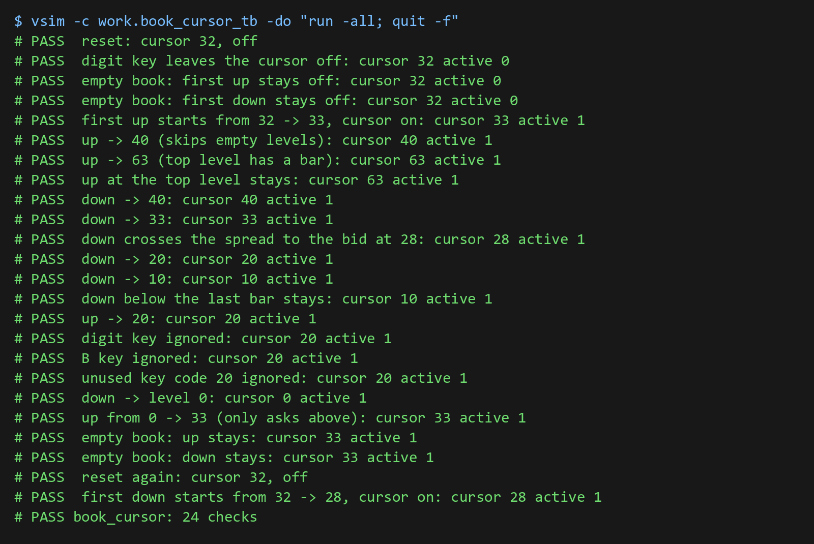

*Figure 30: Book cursor testbench: 24/24 checks. They cover the cursor staying off after reset, skipping empty levels, crossing the spread, stopping at the top and bottom bars, and ignoring other keys.*

## Section 10: The full system on the board (Parth and Pierce)

### 10.1 End-to-end test

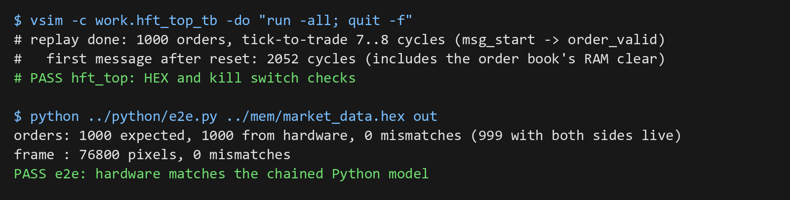

*Figure 31: Pierce's end-to-end test of `hft_top` against the chained model. All 1000 orders match, every one of the 76,800 pixels of the final VGA frame matches, and tick-to-trade is 7–8 cycles for every message.*

### 10.2 Quartus

The complete design (`hft_top`, commit `4d9b429` on `main`) compiles in Quartus Prime Lite 18.1 for the DE1-SoC (5CSEMA5F31C6) with 0 errors and meets timing at 50 MHz:

| Result | Value |
|---|---|
| Fmax (slow 85 °C corner) | 59.22 MHz (the board runs at 50 MHz) |
| Worst setup slack | +3.115 ns |
| Worst hold slack | +0.168 ns |
| Logic | 1,976 ALMs (6%), 1,497 registers |
| Block memory | 311,168 bits (8%) |
| DSP blocks | 4 (used for the multipliers) |

### 10.3 Demo controls

| Input | Function |
|---|---|
| KEY[0] | Reset |
| KEY[1] | Step: one market message per press (when SW[1:0] = 00) |
| KEY[2] | HEX view: bot → market → bid depth → ask depth → entry → fills |
| KEY[3] | Data set: 1000-message market ↔ 13-message test (restarts) |
| PS/2 keyboard | Order entry (Section 4); up/down arrows move the VGA cursor |
| SW[1:0] | Replay: 00 step with KEY[1], 01 auto 4 messages/s, 1x full speed |
| SW[2] | Inventory skew on |
| SW[4:3] | Quote size per side: 1 / 2 / 4 / 8 |
| SW[6:5] | Half-spread: 0–3 ticks |
| SW[8:7] | Max \|position\|: 4 / 8 / 16 / 32 |
| SW[9] | Kill switch (latches until reset) |

| HEX view | HEX5–4 | HEX3–2 | HEX1–0 |
|---|---|---|---|
| Bot | Our bid (`--` = not live) | Our ask | blank |
| Market | Best bid | Best ask | Messages processed (last 2 digits) |
| Bid / ask depth | Best bid / ask price | Shares at that price (4 digits) | |
| Entry | What is being typed (`b P _ _ 1 2`), `b d 0007` = sent as ID 7, `Err` = rejected | | |
| Fills | `b`/`S` for the last fill, then its price | Number of fills (last 3 digits) | |

| LED | On means |
|---|---|
| LEDR[9] | Kill switch latched |
| LEDR[8] | Feed finished |
| LEDR[7] / LEDR[6] | Our ask / bid is live |
| LEDR[5:0] | Risk reject flags: 5 cross, 4 short limit, 3 long limit, 2 size, 1 book one-sided, 0 kill |

## Section 11: Files

| Section | File | Function | Explanation |
|---|---|---|---|
| 0. System | [rtl/hft_top.v](https://github.com/ParthB21/tick-to-trade-latency/blob/main/rtl/hft_top.v) | Top level (on the FPGA) | Connects the whole pipeline to the board: ROM, keyboard, arbiter, book, strategy, risk gate, matching engine, P&L, VGA, HEX views and LEDs |
| | [quartus/milestone1_top.qsf](https://github.com/ParthB21/tick-to-trade-latency/blob/main/quartus/milestone1_top.qsf) | Quartus project | Top level `hft_top`, pin assignments (including PS/2) and every source file |
| 1. Order book | [rtl/order_book.v](https://github.com/ParthB21/tick-to-trade-latency/blob/main/rtl/order_book.v) | The module (on the FPGA) | 8-state FSM, order table (now 2048 × 21), level memory and its two display copies, bid/ask masks, trade event, read ports |
| | [rtl/prio_enc64.v](https://github.com/ParthB21/tick-to-trade-latency/blob/main/rtl/prio_enc64.v) | Priority encoder (on the FPGA) | Best bid = highest set bit of the bid mask, best ask = lowest set bit of the ask mask, in one cycle |
| | [tb/order_book_tb.v](https://github.com/ParthB21/tick-to-trade-latency/blob/main/tb/order_book_tb.v) | Testbench (simulation only) | 27 checks, including the 4 new source-bit checks |
| | [sim/run_order_book.do](https://github.com/ParthB21/tick-to-trade-latency/blob/main/sim/run_order_book.do) | ModelSim script | Compiles, runs and sets up the waveform with named states |
| 2. Matching engine | [rtl/matching_engine.v](https://github.com/ParthB21/tick-to-trade-latency/blob/main/rtl/matching_engine.v) | The module (on the FPGA) | "At or through" comparators, shares left per quote, fill output one cycle after the trade |
| | [python/matching.py](https://github.com/ParthB21/tick-to-trade-latency/blob/main/python/matching.py) | Reference model (laptop only) | The same rules in Python |
| | [python/gen_match_vectors.py](https://github.com/ParthB21/tick-to-trade-latency/blob/main/python/gen_match_vectors.py) | Vector generator (laptop only) | 500 random quote/trade sequences and their expected fills |
| | [tb/matching_engine_tb.v](https://github.com/ParthB21/tick-to-trade-latency/blob/main/tb/matching_engine_tb.v) | Testbench (simulation only) | 13 named cases + 500 vectors |
| | [sim/run_matching_engine.do](https://github.com/ParthB21/tick-to-trade-latency/blob/main/sim/run_matching_engine.do) | ModelSim script | Compiles, runs and sets up the waveform |
| 3. Order arbiter | [rtl/order_arbiter.v](https://github.com/ParthB21/tick-to-trade-latency/blob/main/rtl/order_arbiter.v) | The module (on the FPGA) | 3-state FSM, keyboard priority, `done` routed to the owner, source bit in the ID |
| | [tb/order_arbiter_tb.v](https://github.com/ParthB21/tick-to-trade-latency/blob/main/tb/order_arbiter_tb.v) | Testbench (simulation only) | 3 collision cases + a 360-message stress test, every message tagged and counted |
| | [sim/run_order_arbiter.do](https://github.com/ParthB21/tick-to-trade-latency/blob/main/sim/run_order_arbiter.do) | ModelSim script | Compiles, runs and sets up the waveform with named states |
| 4. Keyboard entry | [rtl/ps2_rx.v](https://github.com/ParthB21/tick-to-trade-latency/blob/main/rtl/ps2_rx.v) | PS/2 receiver (on the FPGA) | Synchronisers, falling-edge detect, 11-bit frame, parity check, 1 ms timeout |
| | [rtl/kb_decoder.v](https://github.com/ParthB21/tick-to-trade-latency/blob/main/rtl/kb_decoder.v) | Scan-code decoder (on the FPGA) | Ignores releases (F0), handles extended keys (E0), maps keys to codes |
| | [rtl/order_entry.v](https://github.com/ParthB21/tick-to-trade-latency/blob/main/rtl/order_entry.v) | Order entry FSM (on the FPGA) | 4-state FSM, BCD digits, checks, builds the 32-bit message, drives the entry display |
| | [rtl/bin2bcd_comb.v](https://github.com/ParthB21/tick-to-trade-latency/blob/main/rtl/bin2bcd_comb.v) | Binary to decimal (on the FPGA) | Shift-and-add-3 for the HEX displays, no `/` or `%` |
| | [rtl/seg7.v](https://github.com/ParthB21/tick-to-trade-latency/blob/main/rtl/seg7.v) | 7-segment decoder (on the FPGA) | Now 5 bits: digits, dash, blank and the letters b S C t E r d P q F |
| | [python/order_entry.py](https://github.com/ParthB21/tick-to-trade-latency/blob/main/python/order_entry.py) | Reference model (laptop only) | Same key grammar and checks in Python; also turns text into PS/2 bytes |
| | [tb/order_entry_tb.v](https://github.com/ParthB21/tick-to-trade-latency/blob/main/tb/order_entry_tb.v) | Testbench (simulation only) | Sends real PS/2 frames; 10 checks |
| | [sim/run_order_entry.do](https://github.com/ParthB21/tick-to-trade-latency/blob/main/sim/run_order_entry.do) | ModelSim script | Compiles, runs and sets up the waveform with named states |
| 5. System test | [python/system_model.py](https://github.com/ParthB21/tick-to-trade-latency/blob/main/python/system_model.py) | System model (laptop only) | Chains every block's model; writes the expected values after every message |
| | [python/sys_compare.py](https://github.com/ParthB21/tick-to-trade-latency/blob/main/python/sys_compare.py) | Checker (laptop only) | Compares the hardware log with the model, column by column |
| | [tb/hft_system_tb.v](https://github.com/ParthB21/tick-to-trade-latency/blob/main/tb/hft_system_tb.v) | Testbench (simulation only) | Runs `hft_top`, steps the ROM, types on the PS/2 pins, logs every message |
| | [sim/kb_script.txt](https://github.com/ParthB21/tick-to-trade-latency/blob/main/sim/kb_script.txt) | Keyboard script | What is typed during the system test, and when |
| | [sim/run_system.do](https://github.com/ParthB21/tick-to-trade-latency/blob/main/sim/run_system.do) | ModelSim script | Compiles, runs and sets up the waveform |
| | [sim/run_m2_checks.ps1](https://github.com/ParthB21/tick-to-trade-latency/blob/main/sim/run_m2_checks.ps1) | Test runner | Runs every Milestone 2 test in batch mode and prints the results |
| 6. P&L tracker | [rtl/pnl_tracker.v](https://github.com/ParthB21/tick-to-trade-latency/blob/main/rtl/pnl_tracker.v) | The module (on the FPGA) | Position, cash, mark and P&L from fills |
| | [python/pnl.py](https://github.com/ParthB21/tick-to-trade-latency/blob/main/python/pnl.py) | Reference model (laptop only) | The same accounting in Python |
| | [tb/pnl_tracker_tb.v](https://github.com/ParthB21/tick-to-trade-latency/blob/main/tb/pnl_tracker_tb.v) | Testbench (simulation only) | 521 cycles against the model |
| 7. Strategy | [rtl/strategy.v](https://github.com/ParthB21/tick-to-trade-latency/blob/main/rtl/strategy.v) | The module (on the FPGA) | 3-state FSM, mid price, half-spread, inventory skew, no-cross clamp |
| | [python/strategy.py](https://github.com/ParthB21/tick-to-trade-latency/blob/main/python/strategy.py) | Reference model (laptop only) | The same quote in Python |
| | [tb/strategy_tb.v](https://github.com/ParthB21/tick-to-trade-latency/blob/main/tb/strategy_tb.v) | Testbench (simulation only) | 225 vectors, 2-cycle latency check |
| 8. Risk gate | [rtl/risk_gate.v](https://github.com/ParthB21/tick-to-trade-latency/blob/main/rtl/risk_gate.v) | The module (on the FPGA) | 6 parallel checks, kill switch, reject flags |
| | [python/risk.py](https://github.com/ParthB21/tick-to-trade-latency/blob/main/python/risk.py) | Reference model (laptop only) | The same checks in Python |
| | [tb/risk_gate_tb.v](https://github.com/ParthB21/tick-to-trade-latency/blob/main/tb/risk_gate_tb.v) | Testbench (simulation only) | 244 cycles, every flag exercised |
| 9. VGA | [rtl/dashboard.v](https://github.com/ParthB21/tick-to-trade-latency/blob/main/rtl/dashboard.v) | The module (on the FPGA) | 5-state drawing FSM: ladder, quote markers, cursor, 4-line panel |
| | [rtl/book_cursor.v](https://github.com/ParthB21/tick-to-trade-latency/blob/main/rtl/book_cursor.v) | Book cursor (on the FPGA) | Up/down to the next non-empty level using the book masks |
| | [rtl/font_rom.v](https://github.com/ParthB21/tick-to-trade-latency/blob/main/rtl/font_rom.v), [rtl/bin2bcd.v](https://github.com/ParthB21/tick-to-trade-latency/blob/main/rtl/bin2bcd.v) | Font and decimal converter (on the FPGA) | 5 × 7 glyphs; sequential binary to decimal for the panel numbers |
| | [python/dashboard.py](https://github.com/ParthB21/tick-to-trade-latency/blob/main/python/dashboard.py), [python/check_dashboard.py](https://github.com/ParthB21/tick-to-trade-latency/blob/main/python/check_dashboard.py) | Screen model and checker (laptop only) | Draws the expected frame and compares every pixel |
| | [tb/dashboard_tb.v](https://github.com/ParthB21/tick-to-trade-latency/blob/main/tb/dashboard_tb.v), [tb/book_cursor_tb.v](https://github.com/ParthB21/tick-to-trade-latency/blob/main/tb/book_cursor_tb.v) | Testbenches (simulation only) | 3 frames of 76,800 pixels; 24 cursor checks |
| 10. End to end | [tb/hft_top_tb.v](https://github.com/ParthB21/tick-to-trade-latency/blob/main/tb/hft_top_tb.v), [python/e2e.py](https://github.com/ParthB21/tick-to-trade-latency/blob/main/python/e2e.py) | Testbench + checker | 1000 orders, the full VGA frame, tick-to-trade cycles |
| Report | [docs/figures/](https://github.com/ParthB21/tick-to-trade-latency/tree/main/docs/figures) | Figures | Every figure in this report, with [FIGURES.md](https://github.com/ParthB21/tick-to-trade-latency/blob/main/docs/figures/FIGURES.md) listing how each one was made |

## Section 12: Next steps

The point of the project is low latency, so the final milestone makes the latency measurable and visible on the board, not only in simulation.

1. **Latency counter in hardware (Parth).** It counts clock cycles from `msg_start` to `order_valid` on every message and keeps the last, minimum and maximum. It is shown on the VGA panel and the HEX displays (e.g. `LAT 8 CYC 160NS MIN 7 MAX 8`), as promised in the proposal.
2. **Per-stage breakdown (both).** One message's waveform through all 7–8 cycles, with the cycles spent in the book, the strategy and the risk gate labelled.
3. **Why the design is fast (both).** We will measure the choices that matter inside our own design:
   - priority encoders (best price in 0 extra cycles) versus scanning the 64 levels (up to 64 cycles);
   - parallel risk checks (1 cycle) versus checking one after another (6 cycles).
4. **Faster where we can (Pierce, then both).** We will try two changes and re-measure each with the counter and the same tests:
   - merge the strategy's 2 cycles into 1 (7–8 → 6–7 cycles);
   - run from a PLL clock faster than 50 MHz. Timing currently allows up to 59 MHz, so the slowest paths would need to be shortened first.
5. **Final demo and presentation.** A scripted demo using the keyboard to cause fills, skew on and off, the kill switch, and the latency readout.
